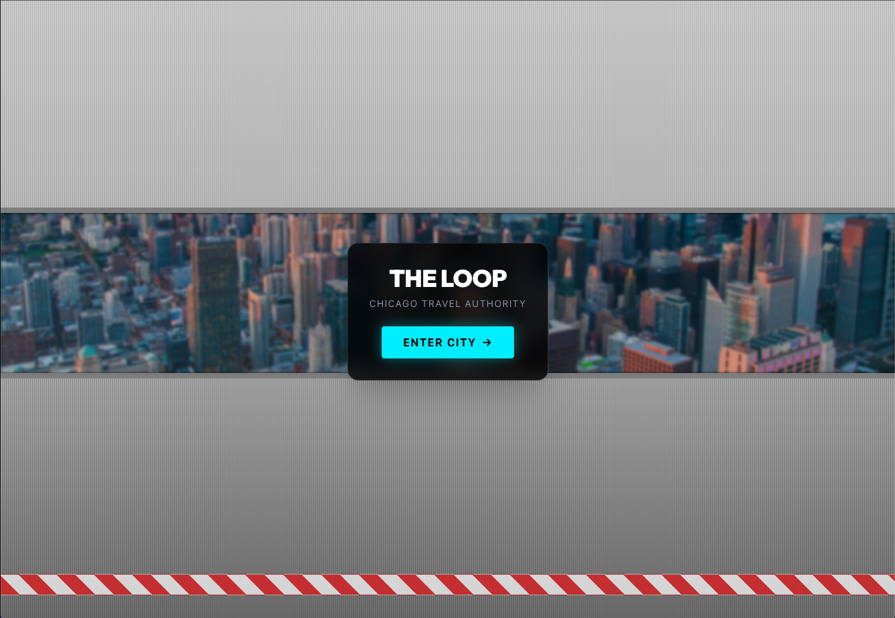
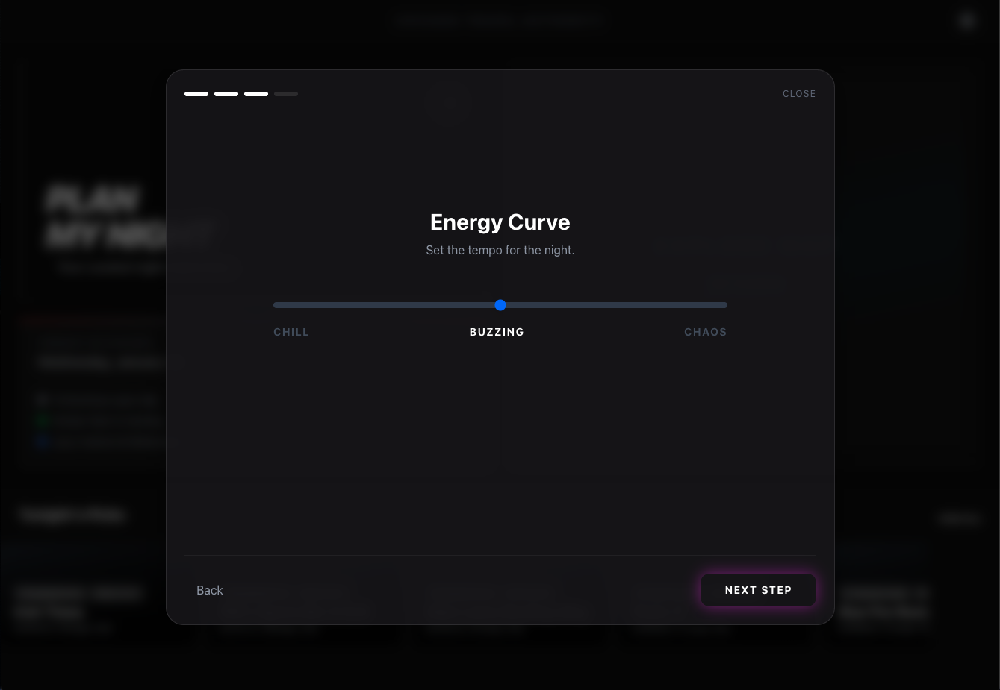
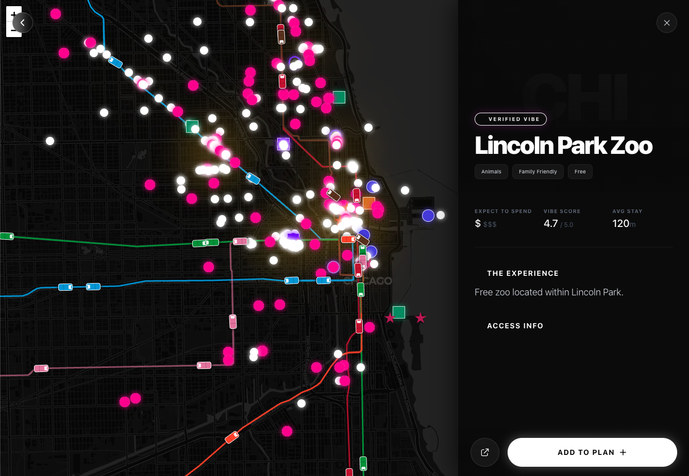

# Chicago Planner App

## About
Chicago Planner is a dynamic travel companion designed to help you discover and organize the perfect trip around the city. Whether you're a local looking for new spots or a tourist planning your first visit, this app allows you to:
- **Explore Interactively**: Visualize landmarks, restaurants, and transit lines on a 3D-enhanced map.
- **Filter by Vibe**: Find locations that match your mood, from "Nightlife" and "Live Music" to "Nature" and "Family Friendly."
- **Plan Smart Itineraries**: Build custom schedules with the Smart Planner wizard that understands travel times and opening hours.
- **Discover Hotspots**: Browse curated, verified locations to ensure you hit the best spots in town.

## Quick Start

### Prerequisites
- Node.js (v18+)
- PostgreSQL (or update .env to point to your DB)

### Setup

1. **Install Dependencies**
   ```bash
   cd client && npm install
   cd ../server && npm install
   ```

2. **Database Setup**
   - **Install PostgreSQL (Mac/Homebrew)**:
     ```bash
     brew install postgresql@14
     brew services start postgresql@14
     createdb chicago_planner
     ```
   - Update `server/.env` if not using default `postgres` user (default for Homebrew is often your system username without password, or 'postgres').
     - *Note*: If connection fails, check `whoami` and set `DATABASE_URL="postgresql://YOUR_USERNAME@localhost:5432/chicago_planner?schema=public"`
   - Run migrations:
     ```bash
     cd server
     npx prisma migrate dev --name init
     ```

3. **Run Development**
   - **Server**: `cd server && npm run dev` (starts on port 3000)
   - **Client**: `cd client && npm run dev` (starts on port 5173)

## Structure
- `client/`: React frontend
- `server/`: Node.js backend
- `shared/`: Shared types

## Walkthrough

### 1. The Entrance
Your journey begins on the "train".


### 2. The Dashboard
The main landing page. From here, you can choose to "Plan My Night" for a curated experience or quickly explore "Tonight's Picks" generated from live data.


### 3. Planning a Night
The "Plan My Night" wizard guides you through reducing decision fatigue.

**Step 1: Choose Categories**
Select what you're interested in (e.g., Nightlife, Food, Culture).


**Step 2: Pick Your Scene**
Choose a neighborhood vibe, from "Trendy Zone" (Wicker Park) to "High Energy" (River North).


**Step 3: Set the Energy**
Dial in your preferred tempo for the night, from "Chill" to "Chaos".


**Step 4: The Details**
Set your start time and budget cap to generate a realistic itinerary.


### 4. Interactive Map
The map is the heart of the experience, featuring vibe-coded markers and real-time transit overlays. You are also able to view the plans from the "Plan My Night" wizard, as seen on the left. 


**Smart Filtering**
Filter places by category to narrow down your options.


**Location Insights**
Tap on any marker to see "Verified Vibes" (places our team has visited and verified), cost estimates, and average stay times. Recent updates (not pictured) also include hours of operation, and menus where applicable. 


**Transit Integration**
See real-time CTA train lines and destinations directly on the map.


### 5. Data Management
An admin dashboard allows for managing the database of locations, tags, and categories.

