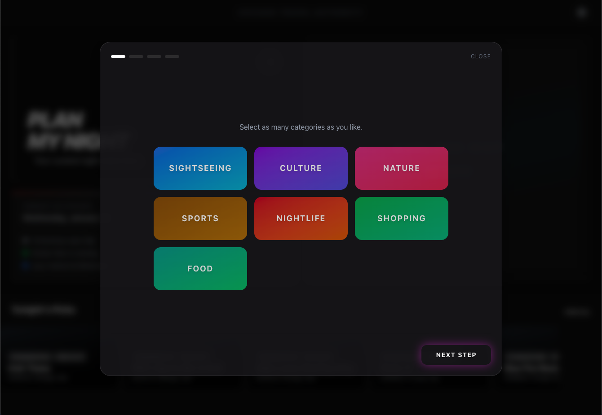
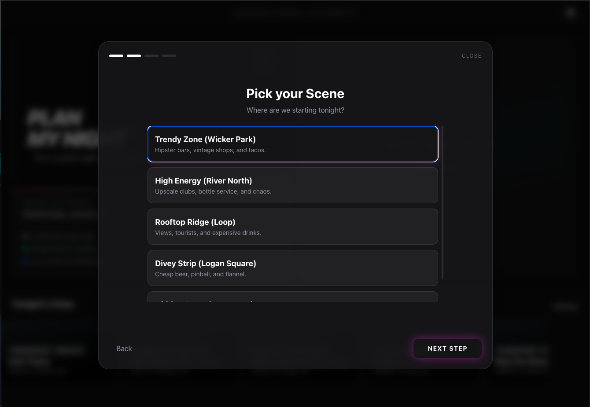
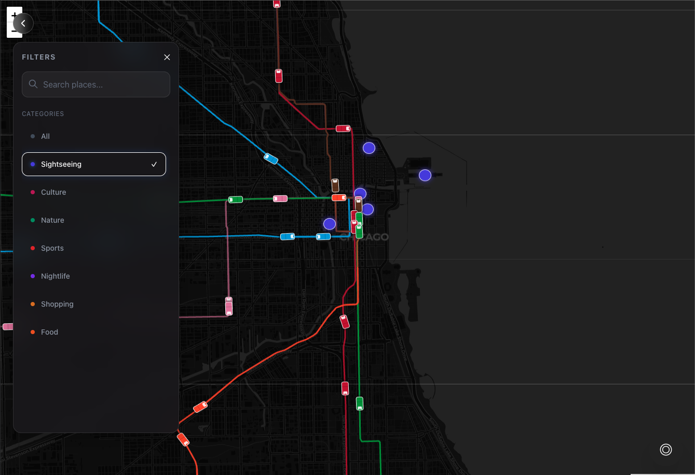

# Chicago Travel Authority

## About
Chicago Planner is a dynamic travel companion designed to help you discover and organize the perfect trip around the city. Whether you're a local looking for new spots or a tourist planning your first visit, this app allows you to:
- **Explore Interactively**: Visualize landmarks, restaurants, and transit lines on a 3D-enhanced map.
- **Filter by Vibe**: Find locations that match your mood, from "Nightlife" and "Live Music" to "Nature" and "Family Friendly."
- **Plan Smart Itineraries**: Build custom schedules with the Smart Planner wizard that understands travel times and opening hours.
- **Discover Hotspots**: Browse curated, verified locations to ensure you hit the best spots in town.

## Quick Start

### Prerequisites
- Node.js 20+ (22 recommended)
- PostgreSQL 14+

### Setup

1. **Install dependencies** (one install for the whole repo — it's an npm workspace)
   ```bash
   npm install
   ```

2. **Configure the server**
   ```bash
   cp server/.env.example server/.env   # then edit DATABASE_URL
   ```
   On a Mac with Homebrew Postgres: `brew install postgresql@16 && brew services start postgresql@16 && createdb chicago_planner`.
   The default Homebrew user is your macOS username with no password, e.g.
   `DATABASE_URL="postgresql://YOUR_USERNAME@localhost:5432/chicago_planner?schema=public"`.

3. **Create the schema and (optionally) demo data**
   ```bash
   npm run db:migrate -w server
   npm run db:seed -w server
   ```

4. **Run it** (two terminals)
   ```bash
   npm run dev:server   # API on http://localhost:3000/api/v1
   npm run dev:client   # app on http://localhost:5173 (proxies /api to the server)
   ```

### Upgrading an existing database (one time)

The migration history used to be out of sync with `schema.prisma` (the schema had been
changed without migrations). If your database was created before this fix, it already
has those columns — mark the catch-up migration as applied, then deploy the rest:

```bash
cd server
npx prisma migrate resolve --applied 20261117000000_sync_schema_drift
npx prisma migrate deploy
```

### Everyday commands (from the repo root)

| Command | What it does |
|---|---|
| `npm run typecheck` | Type-check shared, server and client |
| `npm run lint` | ESLint (client) |
| `npm test` | Unit tests everywhere. Set `TEST_DATABASE_URL` (a DB whose name contains `test`) to also run the API integration tests — **it gets wiped**. |
| `npm run build` | Production build of all three packages |

CI (`.github/workflows/ci.yml`) runs all of the above, including integration tests against Postgres.

## Structure

```
shared/   @cta/shared — the API contract: zod request schemas, response types,
          and pure domain logic (opening hours, Chicago time, distance).
          Used by the server and client; reusable by a React Native app.
server/   Express + Prisma API
  src/app.ts            builds the Express app (no side effects; used by tests)
  src/index.ts          starts it + background transit polling
  src/config.ts         all environment variables, validated at startup
  src/routes/           thin HTTP handlers: validate input -> call a service
  src/services/         business logic and all database access
  src/middleware/       JSON error envelope
  prisma/               schema + migrations
  scripts/              one-off data scripts (seed, enrich, restore)
  tests/                unit + integration tests
client/   React + Vite + Tailwind + Leaflet web app
  src/api/              typed API client (the only place that calls fetch for our API)
  src/hooks/            data-loading hooks
  src/lib/              pure UI logic (heatmap, markers, filters) — unit tested
  src/components/       UI; admin tools live in components/admin (lazy-loaded)
docs/API.md             endpoint reference (start here for a mobile client)
```

## Building a mobile app

The backend is ready to serve an iPhone app as-is: a versioned JSON API (`/api/v1`),
consistent error bodies, ISO timestamps, and no browser-only assumptions (CORS only
matters for websites). See [docs/API.md](docs/API.md).

- **React Native / Expo:** depend on `@cta/shared` directly for types, validation and
  the hours/time helpers; `client/src/lib` logic is plain TypeScript too.
- **Native Swift:** use `docs/API.md` and `shared/src/models.ts` as the contract.
  Generating an OpenAPI spec from the zod schemas would allow generated Swift models.

Before shipping anything public: **add authentication** — every endpoint, including
create/update/delete and import, is currently open to anyone.

## Walkthrough

### 1. The Entrance
Your journey begins on the "train".


### 2. The Dashboard
The main landing page. From here, you can choose to "Plan My Night" for a curated experience or quickly explore "Tonight's Picks" generated from live data.


### 3. Planning a Night
The "Plan My Night" wizard guides you through reducing decision fatigue.

**Step 1: Choose Categories**
Select what you're interested in (e.g., Nightlife, Food, Culture).


**Step 2: Pick Your Scene**
Choose a neighborhood vibe, from "Trendy Zone" (Wicker Park) to "High Energy" (River North).


**Step 3: Set the Energy**
Dial in your preferred tempo for the night, from "Chill" to "Chaos".


**Step 4: The Details**
Set your start time and budget cap to generate a realistic itinerary.


### 4. Interactive Map
The map is the heart of the experience, featuring vibe-coded markers and real-time transit overlays. You are also able to view the plans from the "Plan My Night" wizard, as seen on the left. 


**Smart Filtering**
Filter places by category to narrow down your options.


**Location Insights**
Tap on any marker to see "Verified Vibes" (places our team has visited and verified), cost estimates, and average stay times. Recent updates (not pictured) also include hours of operation, and menus where applicable. 


**Transit Integration**
See real-time CTA train lines and destinations directly on the map.


### 5. Data Management
An admin dashboard allows for managing the database of locations, tags, and categories.

